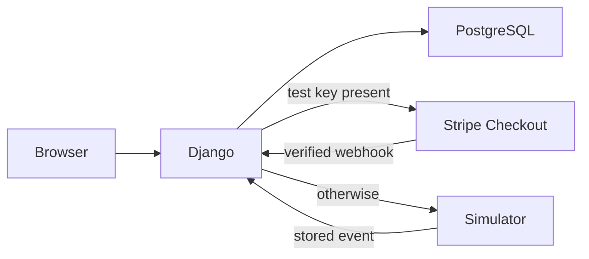

# Payment workflow

The browser never supplies money values. Checkout creates an order and immutable line-item snapshots first, then attaches a single payment. A successful verified provider event transitions the payment and its order in one database transaction. Provider event IDs have a database uniqueness constraint, making webhook delivery idempotent.
